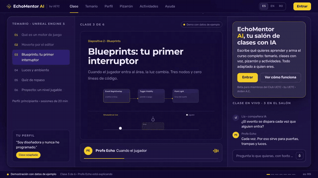
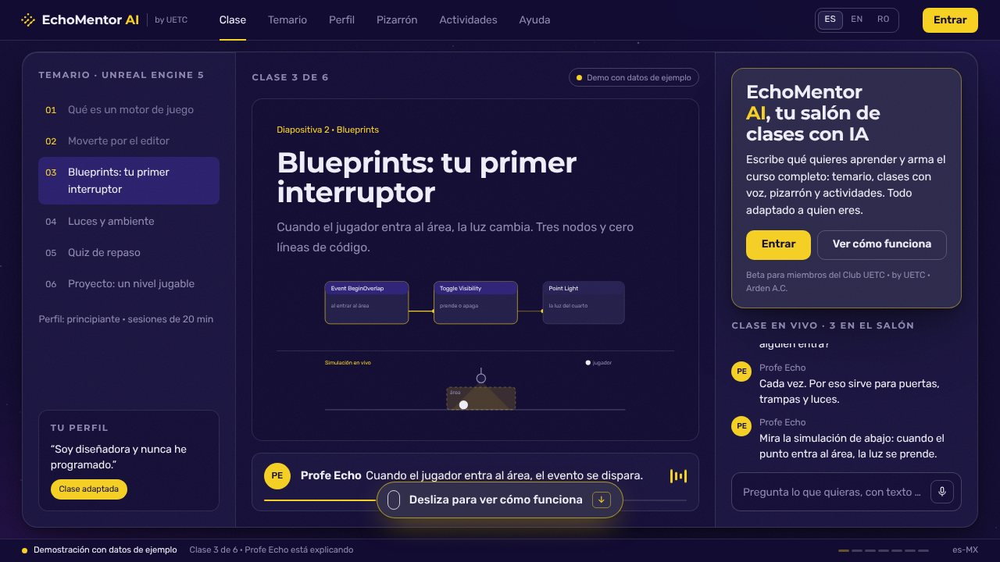
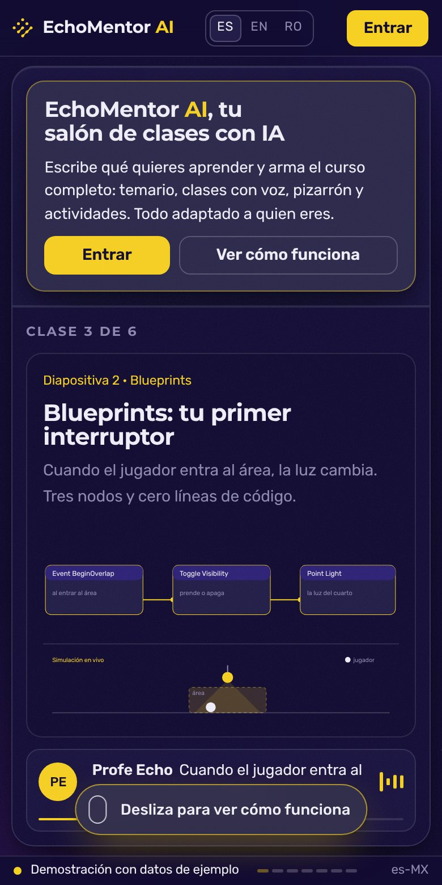

# EchoMentor AI · landing

[English](./README.md) · **Español**

> Landing pública de EchoMentor AI, la plataforma de aprendizaje adaptativo con IA de UETC · Arden A.C.

**[▶ Abrir la landing](https://echomentor.uetc.mx)** · UETC · Arden A.C.

<p align="center"></p>
<p align="center"><sub>Recorrido real del sitio en vivo, grabado el 10 nov 2026 en Chromium (1280×720). Sin retoque. <a href="docs/readme/tour.mp4">Ver el video MP4</a></sub></p>

## ¿Qué es?

La landing pública de **EchoMentor AI**, la plataforma de aprendizaje adaptativo con IA de **UETC · Arden A.C.** Este repo es solo la landing; el código de la plataforma es privado.

## ¿Para quién es?

Para quien quiere entender qué hace EchoMentor antes de entrar, y para los miembros del [Club UETC](https://club.uetc.mx) que ya tienen código de acceso.

## ¿Qué dolor resuelve?

Explicar con texto una plataforma que adapta la clase a cada persona no alcanza: hay que verla funcionando.

## La propuesta

La página se comporta como el producto: una clase ya corriendo, un temario que se arma solo, un perfil del Aprendiz que reescribe el curso, un pizarrón que se dibuja y actividades que funcionan de verdad. Todo usa datos de ejemplo y la propia página lo marca como demo.

## ¿Cómo se usa?

1. Abre [echomentor.uetc.mx](https://echomentor.uetc.mx) y baja por la página.
2. Cambia de idioma con ES · EN · RO, o entra directo con `?lang=es`, `?lang=en` o `?lang=ro`.
3. Si tienes código de acceso, escríbelo en el formulario y entras a la plataforma.
4. Si no tienes código, únete gratis al [Club UETC](https://club.uetc.mx).

## ¿Cuándo conviene y cuándo no?

Conviene para conocer el producto y para que los miembros entren.

La landing no es la plataforma: lo que ves aquí es una demostración con datos de ejemplo y no prueba la disponibilidad de la app.

## ¿Dónde lo pruebo?

En vivo: **[echomentor.uetc.mx](https://echomentor.uetc.mx)**

<p align="center">
  
  
</p>
<p align="center"><sub>Capturas reales del sitio en vivo, 10 nov 2026: escritorio (1280×720) y móvil (390×780).</sub></p>

## Hasta dónde llegamos

La landing está publicada en español, inglés y rumano. La plataforma está en beta dentro del Club UETC.

## Para quien construye

Sitio estático servido con GitHub Pages. El formulario de acceso hace un `POST` normal al conector de la plataforma, funciona sin JavaScript y el código nunca viaja en la URL. La landing no tiene backend.

```bash
npx serve .   # o cualquier servidor estático
```

| Archivo | Qué es |
|---|---|
| `index.html` | La página completa: marcado, estilos y lógica de la demo |
| `i18n.js` | Traducciones (es · en · ro) y datos de la demo por idioma |
| `scrollcraft.js` / `scrollcraft.css` | Motor de scroll, sin modificar |
| `assets/` | Símbolo oficial UETC, ícono, fuentes e imagen para compartir |
| `BRIEF.md` | Brief de diseño |
| `FINGERPRINTS.md` | Registro de huellas para que la siguiente landing no sea un calco |

## Marca, licencia y créditos

- Sigue el [brandkit de Arden v2.4](https://brandkit.uetc.mx) como pieza de UETC. No usa la identidad personal de Jorge Suárez.
- Hecha con [scroll-craft](https://github.com/nateherkai/scroll-craft) (MIT, © Nate Herk). Ver `THIRD_PARTY_LICENSE-scrollcraft.txt`.
- Tipografías Montserrat y Rubik (OFL), autoalojadas.
- © 2026 UETC · Arden A.C. Todos los derechos reservados sobre marca y contenido.

---

<div align="center">

<sub>Repositorio mantenido por <a href="https://github.com/jorgefsb">Jorge Suárez</a> · <a href="./README.md">Read in English</a> · Documentación actualizada el 10 nov 2026.</sub>

</div>
