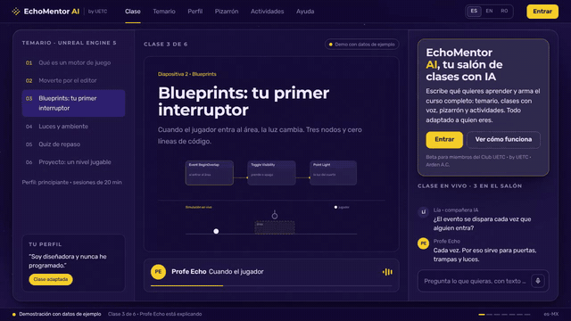
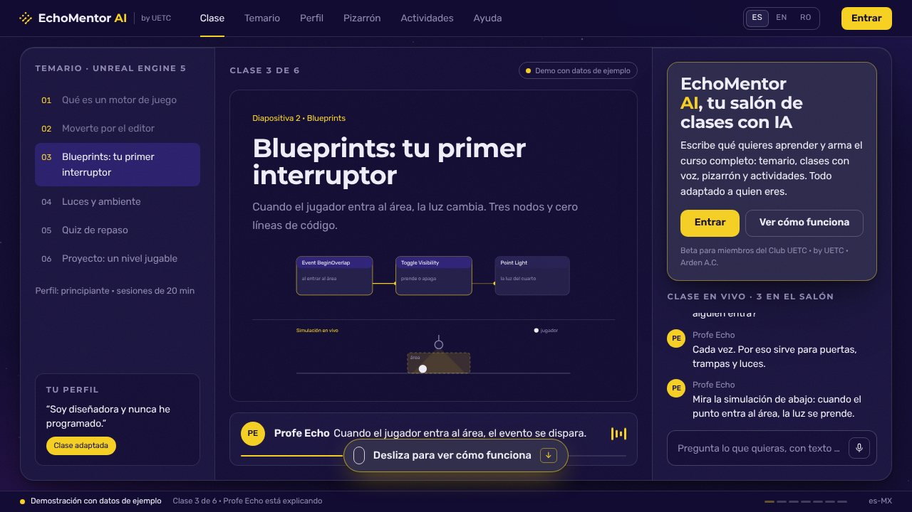
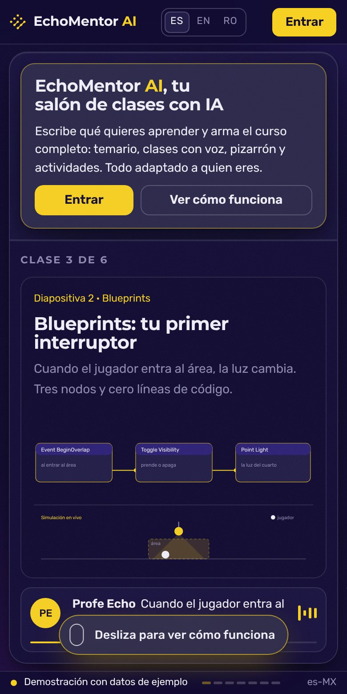

# EchoMentor AI · landing

**English** · [Español](./README.es.md)

> Public landing page for EchoMentor AI, the adaptive learning platform with AI by UETC · Arden A.C.

**[▶ Open the landing page](https://echomentor.uetc.mx/?lang=en)** · UETC · Arden A.C.

<p align="center"></p>
<p align="center"><sub>Real walkthrough of the live site, recorded 10 Nov 2026 in Chromium (1280×720). No retouching. It plays once; reload the page to watch it again. <a href="docs/readme/tour.mp4">Watch the MP4 video</a></sub></p>

## What is it?

The public landing page for **EchoMentor AI**, the adaptive learning platform with AI by **UETC · Arden A.C.** This repo is only the landing page; the platform's code is private.

## Who is it for?

For anyone who wants to understand what EchoMentor does before joining, and for [Club UETC](https://club.uetc.mx) members who already have an access code.

## What pain does it solve?

Text alone cannot explain a platform that adapts the class to each person: you have to see it working.

## The proposal

The page behaves like the product: a class already running, a syllabus that builds itself, a Learner profile that rewrites the course, a whiteboard that draws itself and activities that actually work. Everything uses sample data and the page itself labels it as a demo.

## How do I use it?

1. Open [echomentor.uetc.mx](https://echomentor.uetc.mx/?lang=en) and scroll down the page.
2. Switch language with ES · EN · RO, or go straight in with `?lang=es`, `?lang=en` or `?lang=ro`.
3. If you have an access code, type it into the form and you enter the platform.
4. If you do not have a code, join [Club UETC](https://club.uetc.mx) for free.

## When it fits and when it doesn't

It fits for getting to know the product and for members to sign in.

The landing page is not the platform: what you see here is a demonstration with sample data and it does not prove the app's availability.

## Where can I try it?

Live: **[echomentor.uetc.mx](https://echomentor.uetc.mx/?lang=en)**

<p align="center">
  
  
</p>
<p align="center"><sub>Real screenshots of the live site, 10 Nov 2026: desktop (1280×720) and mobile (390×780).</sub></p>

## How far we got

The landing page is published in Spanish, English and Romanian. The platform is in beta inside Club UETC.

## For builders

Static site served with GitHub Pages. The access form sends a regular `POST` to the platform's connector, works without JavaScript, and the code never travels in the URL. The landing page has no backend.

```bash
npx serve .   # or any static server
```

| File | What it is |
|---|---|
| `index.html` | The whole page: markup, styles and demo logic |
| `i18n.js` | Translations (es · en · ro) and demo data per language |
| `scrollcraft.js` / `scrollcraft.css` | Scroll engine, unmodified |
| `assets/` | Official UETC symbol, icon, fonts and share image |
| `BRIEF.md` | Design brief (in Spanish) |
| `FINGERPRINTS.md` | Fingerprint log so the next landing page is not a copy of this one |

## Brand, license and credits

- It follows the [Arden brandkit v2.4](https://brandkit.uetc.mx) as a UETC piece. It does not use Jorge Suárez's personal identity.
- Made with [scroll-craft](https://github.com/nateherkai/scroll-craft) (MIT, © Nate Herk). See `THIRD_PARTY_LICENSE-scrollcraft.txt`.
- Montserrat and Rubik typefaces (OFL), self-hosted.
- © 2026 UETC · Arden A.C. All rights reserved on brand and content.

---

<div align="center">

<sub>Repository maintained by <a href="https://github.com/jorgefsb">Jorge Suárez</a> · <a href="./README.es.md">Leer en español</a> · Documentation updated on 10 Nov 2026.</sub>

</div>

<!-- HERDR-CONTEXT:START -->
## Contexto del proyecto y clasificación en Herdr

Presentación web de EchoMentor, producto educativo de UETC/Arden.

**Espacio:** `02 LAB | ARD | EchoMentor`. **Unidad:** Arden / UETC / Brandcade.

### Clasificación

La etiqueta LAB identifica una clasificación de catálogo pendiente de revalidación; no implica inactividad. Los números ordenan navegación; no son un ranking de ingresos.

Se conserva la documentación original y el crédito a sus autores. Esta sección no certifica disponibilidad actual ni modifica el runtime. Actualizada el 28-oct-2026.

<!-- HERDR-CONTEXT:END -->
